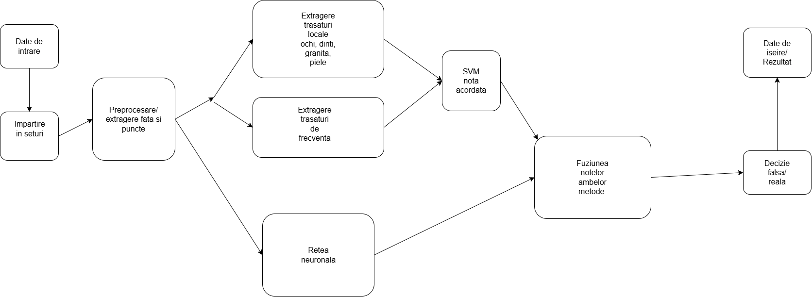

# Proiect-PI Detectia artefactelor mastii faciale si incoerenta de textura

 
## Arhitectura

### Descrierea blocurilor

1. **Date de intrare** - Imagini/ Video-uri de analizat
2. **Impartirea in seturi** - Impartirea imaginilor asemanatoare sau a cadrelor in seturi de date
3. **Preprocesarea** - Gaseste fata si cateva puncte de pe aceasta, apoi o decupeaza cu o margine de 30%
4. **Extragere trasaturi locale** - Foloseste algorithmi clasici de procesare a ochilor, dintilor, pielii si a granitei fetei.
5. **Extragerea trasaturi de frecventa** - Proceseaza imaginea fetei in mediul frecventei folosinf transformata Fourier
6. **SVM** - Separa imaginile reale de cele false in urma rezultatelor obtinute anterior
7. **Retea neuronala** - Foloseste o retea neuronala pentru a analiza seturile si a stabili un scor
8. **Fuziunea** - Se aduc cele doua scoruri pe aceiasi scara si se face media lor
9. **Decizie** - Se stabiliste in functie de scorul final daca imaginea e reala sau falsa
10. **Date de iesire** - O aplicatie in care primesti rezultatele 

## Analiza literaturii de specialitate (State of the Art) - Deepfake Detection

Tabelul de mai jos prezintă o sinteză a principalelor articole și proiecte studiate în domeniul detectării de deepfake-uri:

| NR. | Autor(i) / An | Titlul articolului / proiectului | Aplicație / Domeniu | Tehnologii utilizate | Metodologie / Abordare | Rezultate | Limitări | Comentarii suplimentare |
| :--- | :--- | :--- | :--- | :--- | :--- | :--- | :--- | :--- |
| **1** | Kaede Shiohara, Toshihiko Yamasaki | Detecting Deepfakes with Self-Blended Images | Detectarea de Deepfake-uri / Falsificări faciale | **Datasets:** FF++, CDF, DFD, DFDC, DFDCP, FFIW. **Arhitecturi:** CNN (EfficientNet-b4, ResNet-50, ResNet-152, Xception, EfficientNet-b1). **Biblioteci:** Dlib (repere faciale), RetinaFace (bounding boxes). **Optimizator:** SAM. | Generare de date sintetice de antrenament numite Self-Blended Images (SBI). Această metodă utilizează un Source-Target Generator (STG - generează pseudo-imagini sursă și target plecând de la o singură imagine) și un Mask Generator (MG – generează o mască gray-scale de îmbinare pe baza reperelor faciale). | **AUC la nivel de video (antrenat pe FF++):** • CDF 93,18% • DFD 97,56% • DFDC 72,42% • DFDCP 86,15% • FFIW 84,83% Peste FTCN pe toate seturile (de ex. +6,28 pp pe CDF). Pe DFD, PCL+I2G e mai bun (99,07%). | • Lucrează pe cadre izolate: nu vede incoerențe în timp. • Falsurile cu puține artefacte spațiale pot trece. • Fețe generate integral (FFHQ vs. StyleGAN): doar 69,11% AUC. | Elimină necesitatea căutării costisitoare a celor mai apropiați vecini pentru reperele faciale, proces întâlnit la metodele anterioare, având un timp de rulare constant la generare. Codul sursă a fost făcut public pe GitHub. |
| **2** | Dat NGUYEN, Nesryne MEJRI, et al. / 2024 | LAA-Net: Localized Artifact Attention Network for Quality-Agnostic and Generalizable Deepfake Detection | Detectarea de Deepfake-uri de înaltă calitate și generalizabilă | **Arhitectură:** EfficientNet, FPN. **Biblioteci/Modele:** RetinaNet (decupare fețe), Dlib (68 landmarks), Grad-CAM (vizualizare). **Optimizator:** SAM. | Învățare multi-task cu trei ramuri: (1) clasificare real/fals; (2) o hartă de căldură cu "punctele vulnerabile"; (3) o hartă de auto-consistență față de un punct vulnerabil ales aleator. Atenția rețelei e împinsă spre zonele locale cu artefacte, nu spre toată fața. | **AUC / AP (%), varianta cu SBI:** • CDF2 95,40 / 97,64 • DFW 80,03 / 81,08 • DFD 98,43 / 99,40 • DFDC 86,94 / 97,70 • FF++ (același set): 99,96 AUC. Pe CDF2 cel mai bun concurent e CADDM (93,88 AUC). | • Sensibil la zgomot gaussian. • Doar pe cadre – fără dimensiune temporală. • Pe DFD varianta cu SBI e sub AUNet și CADDM. • Depinde mult de felul falsurilor fabricate: cu BI în loc de SBI, doar 57,13% AUC pe DFW. | Codul sursă a fost publicat pe GitHub. Arată că punctele de pe graniță sunt mai informative decât fața întreagă. Din cauza sensibilității la zgomot, în proiect se testează și robustețea la zgomot și compresie. |
| **3** | Hui Guo, Shu Hu, Xin Wang, et al. / 2022 | Eyes Tell All: Irregular Pupil Shapes Reveal GAN-generated Faces | Criminalistică digitală / Detectarea fețelor false generate de modele GAN | **Detector:** Dlib (68 landmarks). **Model:** EyeCool (U-Net cu encoder EfficientNet-B5 pentru segmentarea pupilei). **Abordare:** Potrivire de elipsă prin cele mai mici pătrate. **Datasets:** FFHQ (reale) și StyleGAN2, 1.600 imagini/clasă (1024x1024). | Segmentează pupila, potrivește o elipsă pe conturul ei și măsoară cât de bine se suprapun, cu Boundary IoU (BIoU). Pupila reală e aproape eliptică (scor mare), cea generată e neregulată (scor mic). Scorul BIoU e folosit direct pentru decizie. | AUC 0,91 (curba ROC) pe 1.600 + 1.600 imagini. Distribuțiile scorului BIoU pentru real și fals sunt clar separate. | • Pot apărea rezultate fals pozitive în cazul fețelor reale cu pupile non-eliptice (infecții, boli). • Variațiile de iluminare, unghiurile puternic înclinate și ocluziunile pot provoca erori în segmentarea pupilei. | Metoda oferă o decizie bazată pe indicii fiziologice clare, rezultatele fiind interpretabile datorită scorului BIoU. S-a demonstrat că artefactul pupilelor neregulate este universal pentru modelele GAN actuale. |
| **4** | Chuangchuang Tan, Yao Zhao, et al. / 2024 | Frequency-Aware Deepfake Detection: Improving Generalizability through Frequency Space Domain Learning | Detectarea de Deepfake-uri / Îmbunătățirea capacității de generalizare | **Tehnologii:** PyTorch, GPU RTX 3090, CNN ușor (1,9 M parametri), FFT / iFFT. **Antrenare:** ForenSynths (ProGAN, 4 clase). **Test:** 17 generatoare, 36.000 imagini. | Forțează rețeaua să lucreze pe frecvențele înalte: FFT, eliminarea frecvențelor joase, apoi iFFT, atât pe imagine cât și pe hărțile de trăsături. Straturi convoluționale aplicate direct pe amplitudinea și faza spectrului. | • 4 clase: acuratețe medie 91,5%, AP 98,5%. • 17 generatoare: acuratețe medie 92,8% (Ojha: 83,0%), cu 1,9 M parametri față de 304 M. • Fețe CelebA-HQ: 98,7–99,5% acuratețe. | • Netestat pe face swap sau video (FF++, Celeb-DF). • AP sub Ojha în unele setări; 69,8% pe Deepfake la antrenarea pe o clasă. • Text și tabel se contrazic la câștigurile pe 1 și 2 clase. | Confirmă că frecvențele înalte poartă urma generatorului. |
| **5** | Z. Yan, Y. Zhang, X. Yuan, S. Lyu, B. Wu / 2023 | DeepfakeBench: A Comprehensive Benchmark of Deepfake Detection | Evaluare, standardizare (benchmark) și platformă de testare unificată | **Tehnologii:** PyTorch, Dlib (detecție și aliniere, fețe 256x256, 32 cadre/video). **Detectoare:** 15 (5 simple, 7 spațiale, 3 de frecvență). **Datasets:** 9 seturi (FF++, CDF v1/v2, DFD, DFDC, DFDC-P, UADFV, FaceShifter, DF-1.0). | Aceeași preprocesare, aceleași date și același protocol pentru toate detectoarele: antrenare pe FF++ c23, test pe 6 seturi din același domeniu și 8 seturi din alte domenii, AUC la nivel de cadru. Plus analize despre augmentări, rețeaua de bază și preantrenare. | AUC la nivel de cadru (media pe alte domenii): SPSL 0,7875, UCF 0,7801, SRM 0,7760. Xception: 0,7365 pe CDF-v2, 0,7077 pe DFDC. În domeniu, cel mai bun: UCF 0,9527. | • Doar detectoare și metrici la nivel de cadru, nu de video. • Fără imagini generate prin difuzie (lăsate pentru viitor). | Benchmark-ul elimină efortul masiv de pregătire a datelor brute, permițând cercetătorilor să se axeze exclusiv pe dezvoltarea metodelor de detectare. |
